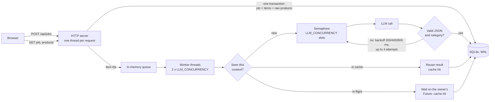

# CatalogIQ design

## 1. Architecture

**How a job moves.** `POST /api/jobs` validates the body, then writes the job, one `job_items`
row per listing and the raw products (status `pending`) in a single transaction, puts the item
ids on a queue and returns 202. That takes about 10 ms for 250 listings. Worker threads take
items off the queue. For each item the worker computes a content key (SHA-256 of the lowercased,
whitespace-collapsed title and description) and, under one lock, sorts the item into one of three
cases: already cached, already in flight, or new. Each finished item is recorded in one
transaction that updates the item, the product, the cache and the job counters together.

**What runs in parallel.** Items, across all jobs. HTTP requests run on their own threads, so
the API does not wait for workers.

**How the limit is enforced.** One `threading.BoundedSemaphore(LLM_CONCURRENCY)` is shared by
the whole process. A worker holds a slot only for the duration of one LLM attempt. Backoff
sleeps and waits for duplicates happen outside the semaphore, which is why there are twice as
many workers as slots: a sleeping worker never leaves a slot idle. Because there is exactly one
semaphore, the limit holds across jobs. A second counter inside the semaphore records the
highest number in flight for `/api/metrics`.

**De-duplication at the same moment.** A dictionary maps content key to a `Future` for content
being enriched right now. The cache lookup and the registration in that dictionary happen under
the same lock, so two workers can never both conclude they are first. The owner writes the cache
row before removing its entry, so a newcomer always finds the result in one place or the other.

**Why threads.** The work is waiting on network calls, where Python releases the GIL, so threads
give real parallelism here. Rejected alternatives:

| Alternative | Why not |
|---|---|
| asyncio | Same throughput for this workload, but needs an async HTTP client and server. That means dependencies, and `sqlite3` is blocking anyway. Threads keep the code readable top to bottom. |
| multiprocessing | No CPU-bound work to speed up, and the semaphore, in-flight map and metrics would all need cross-process sharing. |
| Celery/Redis queue | Right for many machines (see section 3), far too much for a single-process assignment. |
| One shared DB connection behind a lock | Simpler, but API reads would queue behind worker writes. One connection per thread plus WAL lets reads proceed during writes. |
| FastAPI | Nicer validation, but adds installs. The standard library keeps setup to one command. |

## 2. Crash recovery

**What happens today.** The queue is in memory, but it is only a copy: every accepted item is a
`job_items` row with state `pending`. On startup the server re-queues every pending row. Finished
items are not touched, and counters cannot drift because each item's outcome and the job counters
are committed in the same transaction (the update is guarded by `state = 'pending'`, so it applies
once). I tested this by killing the server with `kill -9` at 66 of 250 items: after restart it
resumed 184 items and finished with 250 done and the same 40 cache hits as an uninterrupted run.

**The gap.** A call that was in progress at the crash is repeated. That costs one extra LLM call
per in-flight item, at most `LLM_CONCURRENCY` of them. Enrichment is idempotent, so this is safe.

**For a 10,000-item job at larger scale** I would keep the same idea (the database is the source
of truth, the queue is disposable) and add: a `leased_until` timestamp on items so several worker
processes can claim work without duplicating it and a dead worker's items return to the pool; and
an attempt count stored per item so a restart does not reset the retry budget.

## 3. Scale and cost: 1 million listings a day

1 million a day is about 12 a second on average. In order of payoff:

1. **Cache first.** Marketplace data repeats heavily. The content-key cache already removes
   exact repeats; I would add a looser key (sorted tokens, units normalised) to catch near
   duplicates, and keep the cache in a shared store such as Redis or Postgres.
2. **Batch prompts.** Send 10 to 20 products per request with an id for each and require a JSON
   array back. This divides request count by the batch size, which matters most when the limit is
   requests per minute. Validate each element separately and retry only the ones that failed, so
   one bad answer does not waste the batch.
3. **Shared rate limiter.** The semaphore limits concurrency, not rate. Add a token bucket sized
   to the provider's requests and tokens per minute, held in Redis so every worker on every
   machine draws from it. Honour `Retry-After` on 429 (already done per call).
4. **Several workers and machines.** Move the queue to a durable broker (SQS, Redis streams) or
   to Postgres with `SELECT ... FOR UPDATE SKIP LOCKED`, and run stateless workers. SQLite's
   single writer is the first thing to go.
5. **Second provider as fallback.** Providers already share one interface. Add a circuit breaker:
   after repeated failures or 429s, route to the second provider for a cooling-off period.
6. **Cost.** Use the smallest model that passes the quality checks, keep the prompt short, cap
   output tokens, and send only low-confidence items to a larger model.

## 4. API performance at 5 million products

What makes `GET /api/products?q=...` slow:

- **`LIKE '%q%'`** has a leading wildcard, so no B-tree index applies. Every query scans all
  5 million rows, twice over (clean and raw title).
- **`COUNT(*)`** for `total` scans every match again.
- **`OFFSET`** reads and discards all earlier rows, so page 10,000 is far slower than page 1.

Fixes:

- **Full-text search.** An SQLite FTS5 table (or Postgres `tsvector` with a GIN index, or a
  search engine) over clean and raw titles. For substring matching specifically, a trigram index.
- **Indexes for filters and order.** `(category, sku)` exists already; add `(status, sku)`.
- **Cursor pagination.** `WHERE sku > :last_sku ORDER BY sku LIMIT n` costs the same on every
  page. The brief requires `page`, so I would keep it for shallow pages and add a cursor.
- **Cheaper totals.** Cache counts per filter for a short time, or return an estimate past a cap.
- **Caching.** Short-lived cache of popular queries, invalidated when a job finishes or a
  product is edited.

## 5. Quality: catching invented brands and wrong categories

Cheap automatic checks, each producing a flag:

- **Brand grounding.** The brand must appear in the raw title or description (case-insensitive,
  allowing small spelling differences). If it does not, the model invented it. This catches most
  hallucinated brands for almost no cost.
- **Brand dictionary.** Brands unseen before, or seen only once, are flagged.
- **Category rules.** Compare with a keyword classifier (the mock's rules are a start).
  Disagreement is a flag. "Other" is always a flag.
- **Consistency.** Run near-duplicates or the same brand and product through and compare: the
  same product should not land in two categories.
- **Second opinion.** For flagged items only, ask a second model or the same model again;
  disagreement raises priority.
- **Title drift.** Numbers and units in the clean title must exist in the raw text.

**Who reviews what.** Flags add up to a risk score. Items above a threshold enter a review queue
ordered by score and by business weight (popular or expensive products first). The rest are
auto-accepted, with a random 1 to 2 percent sample reviewed anyway to measure the real error
rate. The UI already supports the review step: edit, then approve. Human corrections become
evaluation data and few-shot examples, and the measured error rate per category sets the
threshold.
